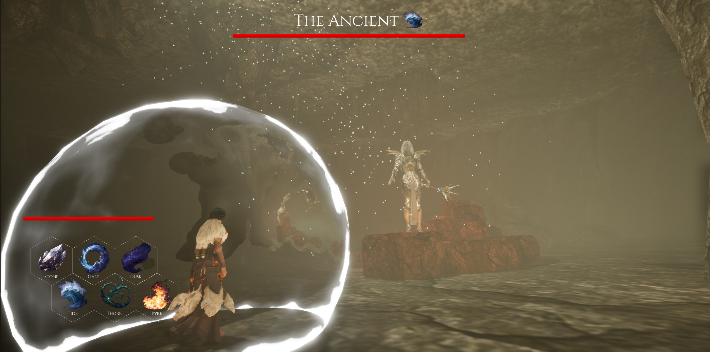
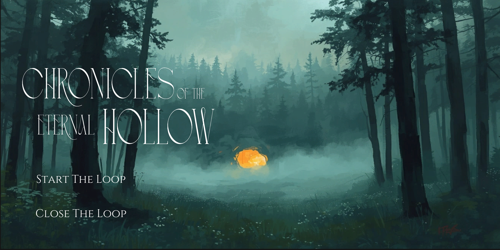
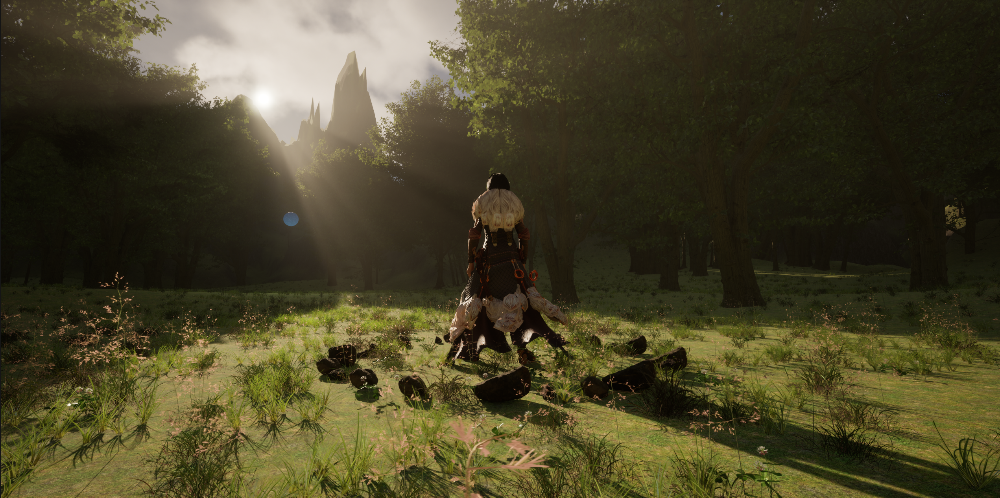
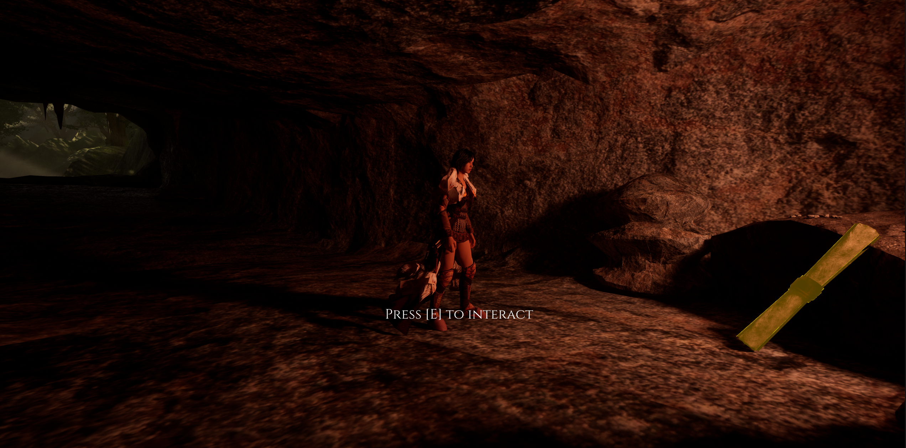

# Chronicles of the Eternal Hollow

A third-person time-loop game built in **Unreal Engine 5.6**. The player faces the same boss again and again, and every death reveals more of the story and the knowledge needed to win the next attempt.

Created as a team final project for Multimedia, TU Wien, 2026S.

**Gameplay video:** [(https://youtu.be/ZZ8YNv5eQKM)]

## Concept

The player wakes up in a foggy forest and follows a guiding light to a cave, where an ancient being waits. The fight is turn-based and built on six elements, each with exactly one counter. Guessing the right counter is nearly impossible, so the player usually dies. That is intended: after each death the player respawns in the forest, and a scroll in the cave reveals a new part of the story, including the counter to the element that killed them. Over the loops, the narration shifts from an old storyteller in third person to the main character, Phoenix, telling her own story in first person once she becomes aware of the loop.

| Element | Countered by |
|---------|--------------|
| Stone   | Dusk         |
| Tide    | Stone        |
| Gale    | Tide         |
| Thorn   | Gale         |
| Dusk    | Pyre         |
| Pyre    | Thorn        |

## Screenshots

| | |
|---|---|
|  |  |
|  |  |

## Features

### Time-loop and game state
- Custom game instance (`GI_TimeLoop`) that persists across deaths: it generates the boss's predetermined attack pattern (`GenerateNewRun`), records each death and respawns the player in the forest (`RecordDeathAndLoop`), and makes sure the intro cutscene plays only once
- Story scrolls that update depending on which element last killed the player, with voice narration that changes narrator mid-story

### Combat system
- Turn-based elemental combat with six elements (Stone, Gale, Dusk, Tide, Thorn, Pyre)
- `BFL_CombatMath`: blueprint function library that resolves each turn into a win or loss
- `BP_CombatManager`: core turn logic, which handles animations, effects, damage, HP checks, and the death and victory states
- Boss intro sequence with camera zoom, boss leap and player repositioning when the player enters the arena
- Combat UI with HP bars for both sides, the boss's upcoming attack, and a hexagonal element selector built from custom buttons
- Elemental shield effect that changes colour with the chosen element, extended from a tutorial
- Elemental attack effects, each wrapped in its own blueprint with sound

### World and atmosphere
- Forest built with the landscape and foliage tools, with exponential height fog and spatial ambient audio
- Custom auto-landscape material (`M_AutoLandscape`) that blends grass and rock based on slope
- Cave with an opening in the ceiling showing a fake sky: in-engine recorded skybox footage played as a video material on a plane
- Guiding light that activates when the player comes close, flies to the cave entrance and disappears in a particle burst
- Interactable highlighting with a custom material and an on-screen prompt

### UI and presentation
- Start and pause menus with a reusable animated button widget
- Settings with master volume and a controls overview
- Intro cutscene, death screen and victory screen with a closing scroll
- MetaHuman player character with custom clothing

## Controls

| Input | Action |
|-------|--------|
| WASD | Move |
| Shift (hold) | Sprint |
| Space | Jump |
| E | Interact |
| P / Esc | Pause menu |
| Mouse | Choose element in combat |

## Team and contributions

Two-person team project.

### Ida Michael
- **Combat system:** designed and implemented the core of the turn-based combat system, including element resolution, damage per element, HP handling and the transitions to the victory and death screens
- **Combat UI and effects:** designed and built the combat UI and the element icons, implemented the elemental shield, and set up the combat effects and sound effects (elements, attacks, death)
- **Animations:** player and boss attack animations, combat animation debugging and the Paragon Serath setup
- **Player character:** created the MetaHuman, rigged it and set it up as the playable third-person character, including fantasy armour clothing and animations
- **World building:** built the mountain landscape and the forest with the foliage tool, and added the environmental fog, skylight and ambient bird sounds
- **Menus:** designed and implemented the start and pause menus with the animated button widget (`WBP_MasterButton`), and designed the logo, font and menu backdrop
- **Story:** wrote the final scroll shown after victory and its text formatting

### Jakob Amstätter-Z.
- **Cave:** created the cave level, sculpted the cave and its walls, cut the ceiling opening, and set up the lighting, decorations and rock texture
- **Fake sky:** implemented the video skybox visible through the cave ceiling
- **Guiding light:** designed the guiding orb, its spline movement and its particles
- **Story system:** added the scroll and its interaction, mapped the scrolls to the boss's elements, and implemented the voice-over logic
- **Combat presentation:** set up the boss fight camera, adjusted the battle blueprint and implemented the intro cutscene
- **Menus:** built the first menu screen and the settings menu, reworked the pause menu and added the reset function
- **Audio:** added the menu, cave and boss fight music and fixed the sound system
- **Gameplay and world:** added sprinting, the initial forest asset placement and the tree and foliage collision
- **Other:** worked on the MetaHuman clothing with MetaTailor, and recorded and edited the project showcase video

### Together
- Brainstorming, concept and project description
- Story writing
- Git and Git LFS setup
- Bug fixing, documentation, builds and the final submission

## About this repository

This repository contains the project file and configuration only. The game logic is implemented entirely in Blueprints, which are stored as binary `.uasset` files, The full project (around 10 GB) is not published because it contains licensed third-party assets that may not be redistributed. See the video and screenshots above for the game in action.

## Credits

- **Environment, boss, effects and animations:** assets from the [Fab](https://www.fab.com) marketplace
  - [Cave asset 1](https://www.fab.com/listings/c6f917b6-ffcb-4b86-9d9f-5274ba7f6a8e), [Cave asset 2](https://www.fab.com/listings/ae2e18fa-906b-490f-9e0e-0e2fde867ec9), [Cave asset 3](https://www.fab.com/listings/30e6c98c-6634-4b7e-b142-2c3cdfde6e1e)
  - [Scroll](https://www.fab.com/listings/ee0bbb45-1b8f-4dbf-bcce-46e5f64d633d)
  - [Combat effects 1](https://www.fab.com/listings/d0fe50c4-6ebe-40d5-b78a-56960832f49e), [Combat effects 2](https://www.fab.com/listings/967b7892-d46c-4d75-8121-33418a6899ce)
  - [Final boss](https://www.fab.com/listings/522b6160-15ab-492b-a2b0-c09f9bb5f6e6)
  - [Death animations](https://www.fab.com/listings/64c53af0-dcb7-4483-9d65-5cbc84bd9a93)
  - [Menu music](https://www.fab.com/listings/09bdff8c-c268-41af-b55b-c1879faf9f21)
  - Cast animation from the Paragon Serath asset
- **Sound effects:** [Pixabay](https://pixabay.com/sound-effects/)
- **Voice narration:** generated with [ElevenLabs](https://elevenlabs.io/)
- **Character clothing:** [MetaTailor](https://www.metatailor.com/)
- **Elemental shield:** based on [this tutorial](https://www.youtube.com/watch?v=szPZRNGT8F0)
- **Menu backgrounds, element icons, death and victory screens:** AI-generated
- **Logo:** created by the team in Canva
- Blueprints were written by the team, partly with AI assistance